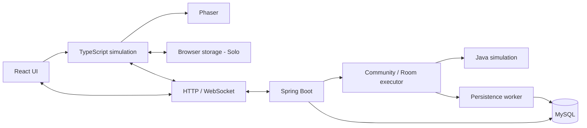

# architecture.md

## Công nghệ và trách nhiệm

| Thành phần | Công nghệ và trách nhiệm |
| --- | --- |
| UI | React + TypeScript: menu, Account, phòng và Records |
| Hiển thị | Phaser: map, sprite, animation và camera; Web Audio/HTMLAudio: âm thanh |
| Solo | TypeScript simulation chạy tại trình duyệt |
| Online | Spring Boot/Java quyết định physics, thời gian, tiến độ và kết quả |
| Persistence | MySQL + Spring Data JPA/Hibernate: identity, lượt chơi, checkpoint và kết quả |



Solo mô phỏng/lưu local, đồng bộ metrics Account qua HTTP khi có mạng. Community/Room nhận input qua WebSocket; Java quyết định state, TypeScript dự đoán nhân vật của mình và nội suy peers. HTTP xử lý identity/Records theo [protocol](protocol.md).

Java/TypeScript dùng chung dữ liệu JSON, viết riêng simulation. Tính trung gian bằng double, ép float32 tại cùng điểm với `Math.fround`. Simulation độc lập Spring/Phaser/DOM/database; không dùng Phaser physics thay simulation.

Adventure tách dữ liệu luật, trạng thái lượt chơi và nội dung hiển thị:

| Phần | Nơi sở hữu |
| --- | --- |
| Trigger hội thoại và tiến độ nội dung | shared/adventure.json; hai simulation cùng dùng |
| Tiến độ hội thoại trong lượt | Simulation; server quyết định online, TypeScript quyết định Solo |
| Câu chữ hội thoại, nhãn, metadata sprite/animation và âm thanh | Frontend; tra cứu bằng ID từ rule/state |

Backend chỉ nạp luật và state gameplay; nội dung hiển thị thuộc frontend.

## Cấu trúc code

`frontend/` dùng npm, `backend/` dùng Maven; build độc lập. `shared/` chứa dữ liệu JSON dùng chung.

```text
backend/
  config/                         # cấu hình mẫu và file riêng được ignore
  src/main/java/jumpking/
    JumpKingApplication.java
    controller/                   # REST endpoints, nhận/trả DTO
    service/                      # nghiệp vụ, transactions và ghi bất đồng bộ
    repository/                   # JPA repositories và query projections
    entity/                       # User, PlayRun, Match ánh xạ MySQL
    dto/                          # request/response, không trả Entity
    security/                     # identity, session, rate limits
    exception/                    # lỗi HTTP thống nhất
    game/                         # Java simulation và luật xếp hạng
    room/                         # Community, Room và lifecycle
    network/                      # WebSocket transport, envelope và connection
    config/                       # Spring wiring, security và cấu hình
  src/main/resources/
  src/test/java/jumpking/          # tests theo package production
  src/test/resources/              # dữ liệu kiểm thử riêng backend
  .mvn/                           # Maven Wrapper
  pom.xml
  mvnw
  mvnw.cmd
frontend/
  public/
    assets/                       # game assets tải động, manifest và ATTRIBUTION.md
  src/
    app/                          # routing và bootstrap
    features/                     # solo, community, rooms, account, records
    components/                   # UI dùng chung
    game/                         # scenes, simulation, netcode, presentation
      content/                    # lời thoại, nhãn và metadata hiển thị theo ID
    network/                      # HTTP/WS adapter
    styles/
    main.tsx                      # entry point
  e2e/
  index.html
  package.json
  package-lock.json
  vite.config.ts
shared/
  maps/                           # Main Babe geometry và metadata
  physics.json                    # tuning vật lý
  rules.json                      # luật/capacity/timing công khai
  adventure.json                  # trigger và tiến độ hội thoại
  fixtures/                       # input traces và expected states
scripts/                          # schema.sql và tác vụ liên module
docs/
```

Java dùng root package `jumpking`, main class đặt tại root để Spring scan. Backend chia theo layer controller/service/repository/entity/dto; `network` chỉ xử lý transport/dispatch, `game` giữ luật thuần. Controller nhận/trả DTO, Service sở hữu nghiệp vụ/transaction, Repository truy cập MySQL. Không trả Entity qua API hoặc giữ managed Entity trong simulation/worker. JPA không nằm trong vòng tick; worker trao đổi snapshot bất biến. Không tạo interface/base class chỉ để chuyển tiếp lời gọi.

Frontend nhóm màn hình/hooks theo feature. `game` giữ simulation/input/presentation/netcode, độc lập React UI; `network` chỉ xử lý HTTP/WS. Unit tests đặt cạnh code; E2E ở `e2e/`.

Phaser tải assets giữ nguyên tên từ `public/assets`; tài nguyên UI được import đặt cạnh component/feature trong `src`.

Dữ liệu shared đóng gói vào cả hai build; backend nạp từ classpath, không phụ thuộc source khi chạy JAR. Client online dùng map/config server công bố và luật adventure cùng bản phát hành. Nội dung frontend liên kết bằng ID; shared không chứa lời thoại/font/đường dẫn assets. URL/secrets theo [deployment](deployment.md).

Profile web đóng gói frontend vào JAR. Static files được browser lưu và revalidate bằng Last-Modified; API giữ no-store. SPA fallback index.html chỉ áp dụng route UI, không áp dụng API/WS/asset thiếu.

JPA tắt Open EntityManager in View, chỉ validate schema khi start. Repository dùng Entity cho ghi và projection cho truy vấn; quan hệ chỉ tải khi cần, không dùng collection hai chiều mặc định. Native query dành cho truy vấn tổng hợp cần thiết. Revision checkpoint/protocol không đồng nghĩa `@Version`; giữ semantics theo [data](data.md).

## Xử lý đồng thời

- Một executor xử lý tuần tự commands, deadlines và ticks của từng sảnh/phòng; các executor dùng chung worker pool. Registry tìm/tạo phòng, executor kiểm tra lại capacity trước Join.
- Simulation fixed-step **60 Hz**, snapshot **20 Hz**, dùng monotonic clock. Không nhận deltaTime từ client hoặc tăng số bước theo số packet.
- Community giữ simulation và active clock riêng cho từng lượt; Pause/chuyển sảnh không thay pha vật lý của lượt đó. Room dùng đồng hồ trận chung.
- Room giữ state, roster, reconnect tokens, xác nhận ván kế tiếp và hạn Host Pause trong RAM; khi paused vẫn xử lý commands/deadlines, không chạy simulation. Resume đặt lại mốc scheduler, không chạy bù ticks thời gian nghỉ.
- Socket validate rồi enqueue; hàng đợi lệnh và callback hoàn tất có giới hạn riêng, ưu tiên callback để không mất save/cleanup khi quá tải. Tick không chờ database hoặc socket chậm; snapshots gộp bản mới nhất, control messages giữ thứ tự.
- Persistence worker xử lý ngoài tick theo [data](data.md). Solo sync không đi qua Java simulation hoặc WS membership.

## Lỗi và khả năng mở rộng

Lỗi command/connection không dừng scheduler; lỗi simulation chỉ cô lập sảnh/phòng bị ảnh hưởng. Khi mất MySQL, tạm dừng lượt Community bị ảnh hưởng, giữ state trong RAM để retry có giới hạn và không báo lưu thành công.

Một backend instance giữ session/membership/gameplay Room trong RAM. Restart mất gameplay Room, chỉ khôi phục checkpoint Community và metrics đã commit; có thể mất tiến độ từ lần ghi cuối. Cách đóng match dở theo [data](data.md#kết-quả-room). Xóa browser storage trước sync có thể mất số liệu Solo.

Luật/Finish/comparator thuộc `game`, persistence thuộc `service`/`repository`, độc lập transport/UI. Mở rộng theo [PLAN](../PLAN.md).

Tham chiếu: [Spring Boot package layout](https://docs.spring.io/spring-boot/reference/using/structuring-your-code.html), [Maven layout](https://maven.apache.org/guides/introduction/introduction-to-the-standard-directory-layout.html), [Vite assets](https://vite.dev/guide/assets.html).
